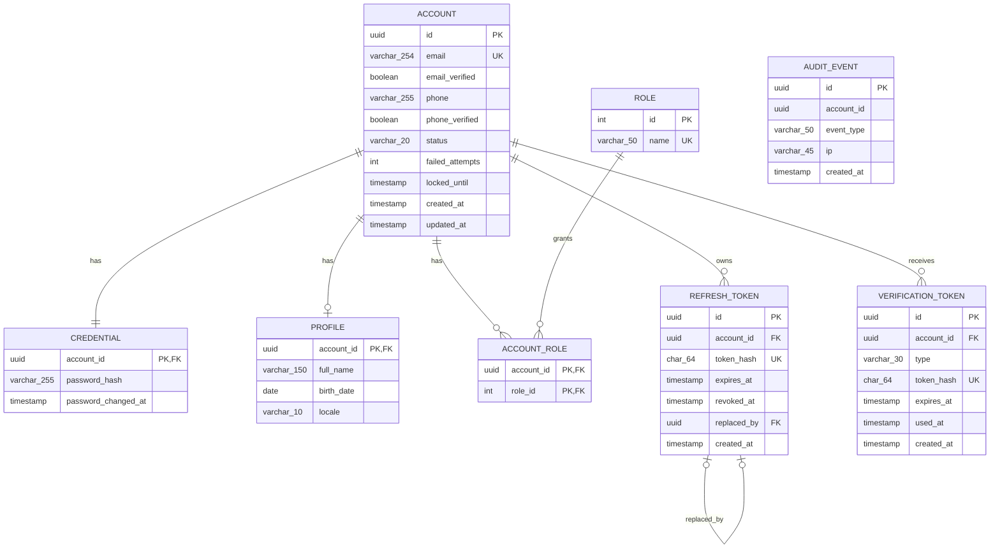

# DER (Diagrama Entidade-Relacionamento)

Modelo de dados do `auth-service`. Convenções: `PK` chave primária, `FK` chave estrangeira, `UK` única, `NULL` aceita nulo. Datas em UTC.

## Diagrama

> O Mermaid não mostra NOT NULL, DEFAULT nem CHECK. A informação completa está nas tabelas abaixo. `AUDIT_EVENT` não tem linha de relacionamento porque não possui FK, de propósito.

## Relacionamentos

| Entidade A    | Entidade B         | Cardinalidade                        |
|---------------|--------------------|--------------------------------------|
| ACCOUNT       | CREDENTIAL         | 1 : 1                                |
| ACCOUNT       | PROFILE            | 1 : 0..1                             |
| ACCOUNT       | ACCOUNT_ROLE       | 1 : N                                |
| ROLE          | ACCOUNT_ROLE       | 1 : N (ACCOUNT e ROLE formam um N:N) |
| ACCOUNT       | REFRESH_TOKEN      | 1 : N                                |
| ACCOUNT       | VERIFICATION_TOKEN | 1 : N                                |
| REFRESH_TOKEN | REFRESH_TOKEN      | auto-relacionamento via replaced_by  |
| AUDIT_EVENT   | ACCOUNT            | apenas lógico, sem FK                |

## Tabelas

### 1. `ACCOUNT`

Identidade e estado da conta. Não guarda senha nem dados pessoais.

| Java      | Campo             | SQL                                                                                |
|-----------|-------------------|------------------------------------------------------------------------------------|
| `UUID`    | `id`              | UUID PK NOT NULL                                                                   |
| `String`  | `email`           | VARCHAR(254) NOT NULL UNIQUE (salvar em minúsculo, trimado)                        |
| `boolean` | `email_verified`  | BOOLEAN NOT NULL DEFAULT false                                                     |
| `String`  | `phone`           | VARCHAR(255) NULL (formato E.164; opcional, ver ADR de telefone)                   |
| `boolean` | `phone_verified`  | BOOLEAN NOT NULL DEFAULT false                                                     |
| `enum`    | `status`          | VARCHAR(20) NOT NULL DEFAULT 'PENDING' + CHECK (PENDING, ACTIVE, LOCKED, DISABLED) |
| `int`     | `failed_attempts` | INT NOT NULL DEFAULT 0                                                             |
| `Instant` | `locked_until`    | TIMESTAMP NULL (NULL = não bloqueada)                                              |
| `Instant` | `created_at`      | TIMESTAMP NOT NULL                                                                 |
| `Instant` | `updated_at`      | TIMESTAMP NOT NULL                                                                 |

Índice: UNIQUE(email).

### 2. `CREDENTIAL`

Segredo da conta (relação 1:1 com ACCOUNT).

| Java      | Campo                 | SQL                                                    |
|-----------|-----------------------|--------------------------------------------------------|
| `UUID`    | `account_id`          | UUID PK, FK -> account(id) NOT NULL, ON DELETE CASCADE |
| `String`  | `password_hash`       | VARCHAR(255) NOT NULL (BCrypt/Argon2, nunca a senha)   |
| `Instant` | `password_changed_at` | TIMESTAMP NOT NULL                                     |

JPA: @OneToOne + @MapsId.

### 3. `PROFILE`

Dados pessoais (relação 1:0..1, a linha é opcional).

| Java        | Campo        | SQL                                                    |
|-------------|--------------|--------------------------------------------------------|
| `UUID`      | `account_id` | UUID PK, FK -> account(id) NOT NULL, ON DELETE CASCADE |
| `String`    | `full_name`  | VARCHAR(150) NOT NULL                                  |
| `LocalDate` | `birth_date` | DATE NULL                                              |
| `String`    | `locale`     | VARCHAR(10) NOT NULL DEFAULT 'pt-BR'                   |

Campos nichados de outras aplicações entram em tabelas novas apontando para account_id.

### 4. `ROLE`

Papéis de permissão (tabela de referência).

| Java      | Campo  | SQL                                            |
|-----------|--------|------------------------------------------------|
| `Integer` | `id`   | INT PK NOT NULL, GENERATED ALWAYS AS IDENTITY  |
| `String`  | `name` | VARCHAR(50) NOT NULL UNIQUE (ex.: USER, ADMIN) |

Seed via Flyway: USER e ADMIN.

### 5. `ACCOUNT_ROLE`

Tabela associativa N:N entre ACCOUNT e ROLE.

| Java      | Campo        | SQL                                                               |
|-----------|--------------|-------------------------------------------------------------------|
| `UUID`    | `account_id` | UUID PK (composta), FK -> account(id) NOT NULL, ON DELETE CASCADE |
| `Integer` | `role_id`    | INT PK (composta), FK -> role(id) NOT NULL                        |

JPA: @ManyToMany + @JoinTable em Account, sem entidade própria.

### 6. `REFRESH_TOKEN`

Refresh tokens com rotação. Só o hash é guardado.

| Java      | Campo         | SQL                                                                             |
|-----------|---------------|---------------------------------------------------------------------------------|
| `UUID`    | `id`          | UUID PK NOT NULL                                                                |
| `UUID`    | `account_id`  | UUID FK -> account(id) NOT NULL, ON DELETE CASCADE                              |
| `String`  | `token_hash`  | CHAR(64) NOT NULL UNIQUE (SHA-256 em hexadecimal)                               |
| `Instant` | `expires_at`  | TIMESTAMP NOT NULL                                                              |
| `Instant` | `revoked_at`  | TIMESTAMP NULL (NULL = ainda válido)                                            |
| `UUID`    | `replaced_by` | UUID FK -> refresh_token(id) NULL (auto-relacionamento; NULL = não rotacionado) |
| `Instant` | `created_at`  | TIMESTAMP NOT NULL                                                              |

Índice: (account_id).

### 7. `VERIFICATION_TOKEN`

Tokens de verificação de e-mail e reset de senha. Só o hash é guardado.

| Java      | Campo        | SQL                                                         |
|-----------|--------------|-------------------------------------------------------------|
| `UUID`    | `id`         | UUID PK NOT NULL                                            |
| `UUID`    | `account_id` | UUID FK -> account(id) NOT NULL, ON DELETE CASCADE          |
| `enum`    | `type`       | VARCHAR(30) NOT NULL + CHECK (EMAIL_VERIFY, PASSWORD_RESET) |
| `String`  | `token_hash` | CHAR(64) NOT NULL UNIQUE (SHA-256 em hexadecimal)           |
| `Instant` | `expires_at` | TIMESTAMP NOT NULL                                          |
| `Instant` | `used_at`    | TIMESTAMP NULL (NULL = não usado; garante uso único)        |
| `Instant` | `created_at` | TIMESTAMP NOT NULL                                          |

Índice: (account_id, type).

### 8. `AUDIT_EVENT`

Histórico de eventos de segurança.

| Java      | Campo        | SQL                                                                                                    |
|-----------|--------------|--------------------------------------------------------------------------------------------------------|
| `UUID`    | `id`         | UUID PK NOT NULL                                                                                       |
| `UUID`    | `account_id` | UUID NULL, SEM FK de propósito (login com e-mail inexistente; histórico sobrevive à exclusão da conta) |
| `enum`    | `event_type` | VARCHAR(50) NOT NULL (LOGIN_SUCCESS, LOGIN_FAILED, PASSWORD_RESET_REQUESTED, PASSWORD_CHANGED...)      |
| `String`  | `ip`         | VARCHAR(45) NULL (comporta IPv6)                                                                       |
| `Instant` | `created_at` | TIMESTAMP NOT NULL                                                                                     |

Índice: (account_id, created_at). Nunca gravar senha ou token.

## Decisões embutidas (candidatas a ADR)

1. ON DELETE CASCADE nas tabelas filhas: excluir a conta remove credencial, perfil e tokens. A auditoria permanece.
2. status e type como VARCHAR + CHECK, em vez de enum nativo do banco (mais portável entre Postgres, H2 e Oracle).
3. UUID como PK em tudo, exceto ROLE (tabela de referência pequena).
4. Tokens guardados só como hash SHA-256; senhas com BCrypt/Argon2.
5. Datas em UTC (Instant em Java, TIMESTAMP no banco).
6. Em Oracle, UUID vira RAW(16) ou VARCHAR2(36) e BOOLEAN vira NUMBER(1) (antes do 23ai).